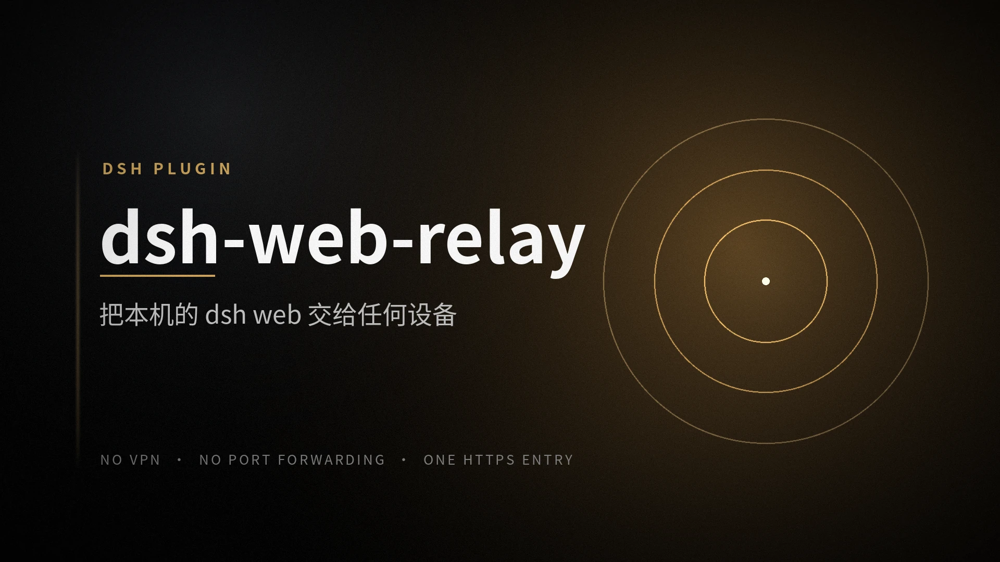
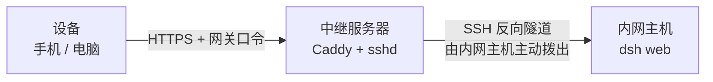

<div align="center">

# dsh-web-relay

**让远程设备安全使用你机器上的 `dsh web` —— 不需要 VPN，也不需要端口转发**



[](./LICENSE)

</div>

---

## 这是什么

[DeepSeek Harness](https://github.com/deepseek-ai/deepseek-harness)（`dsh`）的一个插件。装上它，你就能在手机或另一台电脑上打开跑在家里、办公室那台机器上的 `dsh web`。

内网主机主动向一台有公网地址的中继服务器拨出 SSH 反向隧道；中继用 Caddy 终止 TLS、校验一道网关口令，再把请求交给内网主机。**内网主机不开放任何入站端口，中继上也不安装本项目的任何代码**——只用系统自带的 `sshd` 与 Caddy。

## 为什么需要它

`dsh web` 只监听 `127.0.0.1`，这是它安全模型的一部分：DSH 的认证是单操作者的——一个启动令牌换一个长期 Cookie，没有多用户、没有吊销列表、没有频率限制。把它直接摆到公网，等于把一个能执行命令的界面摆到公网。

所以「人在外面，想用家里那台机器上的 `dsh web`」缺的不是一条能穿透 NAT 的通道，而是一条既穿透、又不会顺手拆掉认证边界的通道。

## 你会得到什么

- **内网主机不开放任何入站端口。** 连接方向永远由内网主机发起，公网扫不到它；浏览器只与中继通信。
- **一次点击配好整条链路。** 在设置页填好参数点「部署」，引导会用管理账号在中继上自动完成受限账号、sshd 加固、Caddy、证书与隧道。过程幂等，失败可原样重跑。
- **四层互相独立的认证。** TLS 校验、网关口令、DSH 会话 Cookie、Host/Origin 围栏分别挡在不同位置；中继上不存任何 DSH 凭据，也只有一个 HTTPS 端口。

## 工作方式



中继上的隧道端点只绑在 loopback，能连它的只有同一台机器上的 Caddy。DSH 自己仍然只听 `127.0.0.1`，从不接触公网。

## 快速开始

前置条件：

- 一台有公网地址的中继服务器（任意 VPS），安全组放行你要用的网关端口
- 该服务器上，管理账号可以公钥登录，并且能免密 `sudo`
- 本机已装好 DSH，可以正常运行 `dsh web`

从 npm 安装：

```sh
dsh plugin --profile web add dsh-web-relay
```

或者从源码安装（`lib/` 不入库，必须先构建）：

```sh
git clone https://github.com/LFF28/dsh-web-relay.git
cd dsh-web-relay
pnpm install && pnpm run build
dsh plugin --profile web add file:"$(pwd)"
```

重启 `dsh web`，然后在**服务器本机**打开 `http://127.0.0.1:<dshPort>`，进入 **设置 ▸ 远程访问**，填入中继地址、管理账号与网关口令，点「部署」。

首次配置必须在服务器本机完成：DSH 对非 loopback 页面把设置持久化降级为内存，远程页面写不了设置。

部署成功后，终端上会打印这样一行：

```text
dsh-web-relay: https://203.0.113.7:8443/
  根证书指纹 SHA256:…
  中继主机密钥 SHA256:…
  Caddy v2.11.4
```

把第一行那个地址收藏到设备上即可。建议同时把中继 CA 的根证书装到设备，否则每次访问都要手动点过浏览器证书警告，而且**没有身份验证**——根证书不经过公网分发，在设置页状态区点「下载根证书」取回再送到设备，装之前核对指纹。

## 配置与文档

插件的配置项不多：设置页里有中继地址、管理账号、网关端口与网关口令等部署参数；包内还有一组带默认值的行为旋钮（重连退避、超时、入口开关等）。

| 文档 | 内容 |
| --- | --- |
| [文档索引](docs/README.md) | 全部文档的入口与术语表 |
| [工作原理](docs/how-it-works.md) | 拓扑、四层身份、设计上坚持的不变量 |
| [部署指南](docs/deployment.md) | 前置条件、配置步骤、部署时每一步做了什么 |
| [配置项](docs/configuration.md) | 每个字段的类型、默认值与注意事项 |
| [插件改动了什么](docs/local-changes.md) | 本机与中继上的每一处改动、权限、卸载残留 |
| [安全设计](docs/security.md) | 威胁模型、分层防御、必须成立的前提、已知限制 |
| [排障与维护](docs/troubleshooting.md) | 症状定位、常见变更流程、中继侧核对清单 |

## 安全提示

这个插件把一个能执行命令的界面接到公网，因此有几条前提值得你先读一遍 [安全设计](docs/security.md)：

- **网关口令是必需的**，不是可选加固。DSH 自身的认证强度不足以直接面向公网。
- **中继上只应跑 `sshd` 与 Caddy**，且只开网关一个 HTTP 端口——Cookie 不按端口隔离，多一个端口就多一条读到会话 Cookie 的路。
- **中继主机被攻破时隧道上的明文流量可被读到**，这是本架构的固有代价，也是它需要你当一台机器来维护的原因。
- **不装 CA 就没有身份验证**，只有加密。请把这一条当作一个需要你明确做出的决定。

## 许可

[MIT](LICENSE)

## 关于作者

由 [LFF28](https://github.com/LFF28) 维护。插件面向 DSH，与 DeepSeek 官方仓库相互独立。
